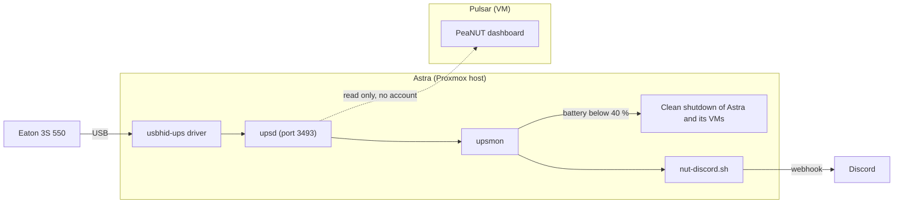

# UPS on Astra (NUT)

An Eaton 3S 550 UPS is plugged into Astra over USB. NUT (Network UPS Tools) reads it, shuts Astra
down cleanly when the battery runs low and posts each power event to Discord. PeaNUT on Pulsar
([`docker/peanut`](../../../docker/peanut)) displays the readings.

This directory holds a copy of every file involved, with the secrets replaced by `CHANGE_ME`, so
the setup can be rebuilt after a fresh install of Astra or a broken edit. The install overview is
in [`docs/deployment.md`](../../../docs/deployment.md#8-set-up-the-ups-on-astra-nut), section 8.

## Layout



## How an outage unfolds

The UPS switches to battery and `upsmon` posts the event to Discord. When the charge falls below
40 %, `upsmon` shuts Astra down: its virtual machines first, Pulsar included, then the host. As the
last step, the UPS is told to cut its output after `ups.delay.shutdown` seconds. If the mains has
come back by then, the output returns `ups.delay.start` seconds later and Astra boots again.

## Files

Each file is a copy of the installed one, with the comments of the configuration files left out.
`CHANGE_ME` marks each value to generate again.

| Repository file    | Destination on Astra                 | Owner and mode  |
| ------------------ | ------------------------------------ | --------------- |
| `nut.conf`         | `/etc/nut/nut.conf`                  | `root:nut` 640  |
| `ups.conf`         | `/etc/nut/ups.conf`                  | `root:nut` 640  |
| `upsd.conf`        | `/etc/nut/upsd.conf`                 | `root:nut` 640  |
| `upsd.users`       | `/etc/nut/upsd.users`                | `root:nut` 640  |
| `upsmon.conf`      | `/etc/nut/upsmon.conf`               | `root:nut` 640  |
| `nut-discord.sh`   | `/usr/local/bin/nut-discord.sh`      | `root:root` 755 |
| `99-nut-ups.rules` | `/etc/udev/rules.d/99-nut-ups.rules` | `root:root` 664 |
| `nut-tui.sh`       | `/usr/local/bin/nut-tui`             | `root:root` 755 |

## Accounts

| Account  | Purpose                                         | Rights                                                                   |
| -------- | ----------------------------------------------- | ------------------------------------------------------------------------ |
| `upsmon` | Automatic shutdown, named on the `MONITOR` line | `upsmon master`                                                          |
| `enoal`  | Administration, by hand or through the menu     | `SET`, and the commands `beeper.enable`, `beeper.disable`, `beeper.mute` |
| none     | PeaNUT reading the measures from Pulsar         | none: reading needs no account                                           |

Commands that cut the outlets (`load.off`, `load.off.delay`, `shutdown.stayoff`,
`shutdown.return`, `driver.killpower`) are granted to no account, so a leaked password cannot
power Astra and Pulsar off. The `upsmon` password lives only in `upsd.users` and `upsmon.conf`:
a restore generates a new one and nothing else needs the old value.

## Administration menu

`nut-tui.sh` is a small `whiptail` menu on top of `upsc`, `upscmd` and `upsrw`. It shows the state
of the UPS, mutes, disables or enables the beeper, and changes the two transfer voltages. It
stores no password: `upscmd` and `upsrw` ask for the `enoal` password on the keyboard when an
action needs it. The commands that cut the outlets are not in the menu.

```sh
scp infra/astra/nut/nut-tui.sh astra:/tmp/
ssh astra "sudo install -o root -g root -m 755 /tmp/nut-tui.sh /usr/local/bin/nut-tui && rm /tmp/nut-tui.sh"
ssh -t astra nut-tui
```

## Restore from scratch

1. Install the package and copy the files, then set owner and mode as in the table above:

   ```sh
   sudo apt install nut
   ```

2. Replace each `CHANGE_ME` in `upsd.users` and `upsmon.conf`. Use the same password for the
   `upsmon` account in both files. Generate it with `openssl rand -hex 24`.
3. Put the Discord webhook URL in `nut-discord.sh` (`WEBHOOK_URL`).
4. Reload the udev rule so the `nut` group can open the USB device, then start the services:

   ```sh
   sudo udevadm control --reload-rules && sudo udevadm trigger --subsystem-match=usb
   sudo systemctl restart nut-driver@eaton3s nut-server nut-monitor
   ```

5. Check, in this order:

   ```sh
   upsc eaton3s@192.168.1.200 ups.status
   sudo journalctl -u nut-monitor --since '-2 min'
   ```

   The first command answers `OL` on mains power. The journal must not show `Login failed` or
   `Communications with UPS lost`. The lines `addchar: discarding invalid character` are
   expected: `upsmon` cannot read the emoji in the `NOTIFYMSG` lines.

> [!WARNING]
> Never test the automatic shutdown with `upsmon -c fsd`: it powers Astra off for real.

## Settings held by the UPS and the driver

Read with `upsc eaton3s@localhost` and `upsrw eaton3s@localhost`. After a hardware replacement,
read them again and compare.

| Variable              | Value                 | Meaning                                                                 |
| --------------------- | --------------------- | ----------------------------------------------------------------------- |
| `input.transfer.high` | 264                   | Mains voltage (V) above which the UPS switches to battery               |
| `input.transfer.low`  | 184                   | Mains voltage (V) below which the UPS switches to battery               |
| `outlet.desc`         | `Main Outlet`         | Label of the main outlet                                                |
| `outlet.1.desc`       | `PowerShare Outlet 1` | Label of the switchable outlet                                          |
| `battery.charge.low`  | 40                    | Charge (%) at which the shutdown starts, set in `ups.conf`              |
| `ups.delay.shutdown`  | 20                    | Seconds between the final shutdown order and the UPS cutting its output |
| `ups.delay.start`     | 30                    | Seconds between the return of the mains and the output coming back      |
| `ups.beeper.status`   | `disabled`            | Audible alarm, turned off on purpose; `beeper.enable` turns it back on  |

Change one with `upsrw -s <variable>=<value> -u enoal eaton3s@localhost` (the password is asked
on the keyboard).

The two delays are the driver defaults (`offdelay` 20 and `ondelay` 30), which `ups.conf` does
not set. According to the NUT documentation, `upsrw` changes them in memory only and the
automatic shutdown reads `ups.conf`, so a lasting change goes there as `offdelay` and `ondelay`,
followed by `sudo systemctl restart nut-driver@eaton3s`.

## Known quirks

- **Reloading `upsd`**: `upsd -c reload` fails (no PID file). Use
  `sudo systemctl reload nut-server` and `sudo systemctl reload nut-monitor`.
- **Order of changes**: when the shutdown account changes, create it in `upsd.users` and reload
  `nut-server` first, then edit the `MONITOR` line and reload `nut-monitor`. A wrong `MONITOR`
  line leaves the automatic shutdown inactive, so read `journalctl -u nut-monitor` after the
  change.
